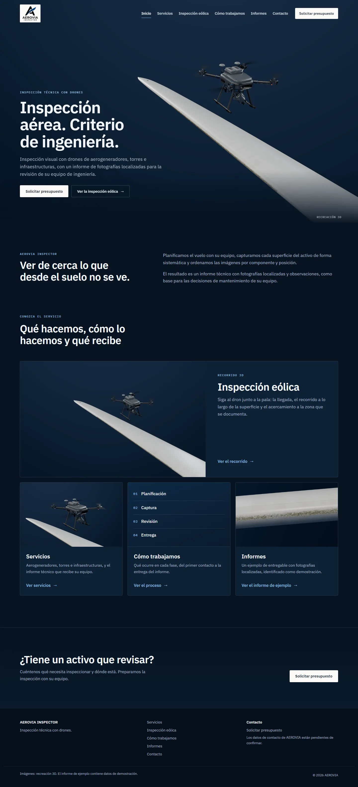
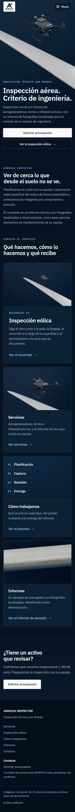

# AEROVIA INSPECTOR · demo web

Demo de una web para AEROVIA INSPECTOR, inspección técnica con drones: seis páginas con rutas propias sobre la estética de estudio azul marino del rediseño (un dron y un tramo de pala, renderizados con trazado de rayos desde la escena 3D del proyecto).

Es una demo: no está publicada y no sustituye ni modifica la web actual del cliente.

| Escritorio (1440×900) | Móvil (390×844) |
| --- | --- |
|  |  |

Capturas de todas las páginas en [docs/screenshots](docs/screenshots). La propuesta visual y sus revisiones están en [docs/rediseno-web](docs/rediseno-web), y el origen de cada recurso en [ASSETS.md](ASSETS.md).

## Páginas

| Página | Ruta (GitHub Pages) | Contenido |
| --- | --- | --- |
| Inicio | `/aerovia-inspector-demo/` | Portada, presentación y accesos al resto de páginas |
| Servicios | `servicios/` | Aerogeneradores, torres e infraestructuras, e informe técnico |
| Inspección eólica | `inspeccion-eolica/` | El recorrido en tres momentos y la captura, con el scroll |
| Cómo trabajamos | `como-trabajamos/` | Planificación, captura, revisión y entrega |
| Informes | `informes/` | Un informe de ejemplo, identificado como demostración |
| Contacto | `contacto/` | Qué incluir en una solicitud; los datos de AEROVIA, cuando se confirmen |

- **Rutas reales.** Cada página es un HTML propio en su carpeta (build multipágina de Vite), así que un enlace directo, recargar o usar atrás y adelante funcionan sin redirecciones. Las direcciones van bajo la base `/aerovia-inspector-demo/`, configurable con `BASE_PATH`. Las direcciones que no existen muestran `404.html`.
- **Partes comunes.** La cabecera, el menú y el pie se escriben en cada página al servir o compilar ([src/site/partials.ts](src/site/partials.ts)), con los textos de [src/content/site.ts](src/content/site.ts). El menú abre páginas, no anclas, y marca la actual.
- **Sin JavaScript** todo se lee y se navega: el menú móvil es un `<details>`, y la inspección se muestra como imágenes con su texto. El JavaScript ([src/site/main.ts](src/site/main.ts)) solo cierra el menú, copia la plantilla de contacto y convierte la inspección en un reproductor por scroll ([src/site/player.ts](src/site/player.ts)).
- **Inspección por scroll.** Las imágenes de los momentos comparten un escenario fijo y cambian con fundido según la posición del scroll: avanza, retrocede y se para con él. Los textos van en su propia columna (o debajo, en móvil vertical), nunca sobre el dron ni la pala. Con movimiento reducido, la página es estática. El escenario está preparado para recibir más adelante una secuencia de fotogramas.
- **Contacto.** No hay formulario: no hay un destino configurado y no se muestra nada que aparente enviar. Cuando AEROVIA confirme su correo o teléfono, se escriben en `src/content/site.ts` y aparecen en la página y en el pie.

## Estado

### Terminado en esta revisión

- Las seis páginas, la 404, la navegación común y las imágenes de estudio.
- Dron mejorado (bahía de baterías, antenas RTK, bisagras, gimbal) y superficie de pala con erosión realista en el detalle.
- Comprobaciones de contenido, contraste y navegador (ver más abajo).

### Provisional o pendiente

- **Dron.** Sigue siendo el modelo procedural genérico del proyecto, mejorado pero provisional. Para el acabado final hace falta el modelo del dron de AEROVIA o uno genérico con licencia (ver [ASSETS.md](ASSETS.md)).
- **Secuencia larga de la inspección.** No se ha producido: espera a la aprobación de las capturas y del modelo de dron definitivo. Mientras, el reproductor usa fotogramas clave.
- **Logo.** Falta una versión vectorial o PNG transparente; se usa el original sobre una placa clara.
- **Contacto.** Correo y teléfono pendientes de que AEROVIA los confirme.
- **Textos.** Redactados a partir de la web actual del cliente y del contenido ya aprobado, sin cifras ni promesas. Necesitan su revisión.

## Ejecutar

Requisitos: Node 20 o posterior (probado con 24.21.0) y npm. Para las comprobaciones de navegador hace falta Chrome o Edge; `BROWSER=/ruta/al/navegador` permite elegir otro.

```bash
npm ci
npm run dev
npm run check
npm run build
npm run preview
npm run e2e
```

- `npm run dev`: desarrollo en http://localhost:5173/aerovia-inspector-demo/
- `npm run check`: typecheck, tests unitarios y build.
- `npm run build` y luego `npm run preview`: la build de producción en http://localhost:4174/aerovia-inspector-demo/
- `npm run e2e`: comprobaciones de navegador contra `preview` (`--shots=docs/screenshots` guarda además las capturas).
- `npm run images`: copia los renders de `docs/rediseno-web/render` al sitio, con versiones reducidas y la imagen para compartir.

Los renders se hacen con las herramientas de `propuestas/` y `scripts/` (ver [docs/rediseno-web/propuesta.md](docs/rediseno-web/propuesta.md)), con `npm run dev` en marcha.

## Estructura

```
index.html, servicios/, inspeccion-eolica/, como-trabajamos/, informes/, contacto/, 404.html
src/
  content/site.ts       textos comunes, menú, servicios, proceso, informe de ejemplo y contacto (editable)
  site/                 partes comunes de las páginas, menú, reproductor de la inspección
  styles/               tokens (base.css) y estilos del sitio (site.css)
  assets/               logo e imágenes de estudio del sitio
  experience/           modelos 3D (dron, aerogenerador), materiales y trayectoria: los usan los renders
propuestas/             escena de estudio, superficies y páginas de render (fuera de la build)
tests/                  contenido, navegación y contraste; trayectoria del dron
e2e/                    comprobaciones de navegador
scripts/                renders, imágenes del sitio y derivados del logo
```

## Publicación (no realizada)

- **Base configurable.** La build usa la base `/aerovia-inspector-demo/` de GitHub Pages. `BASE_PATH` la cambia para otro alojamiento. `SITE_URL` (la dirección pública, cuando exista) añade URL absolutas a la imagen para compartir y a la etiqueta canonical.
- **Flujo de publicación.** [.github/workflows/deploy.yml](.github/workflows/deploy.yml) solo se ejecuta a mano (`workflow_dispatch`). Fusionar no publica nada.
- **Requisito previo.** El titular del repositorio debe activar GitHub Pages con la fuente «GitHub Actions».
- **Vercel.** No se toca: la web del cliente sigue como está.

## Pruebas

### Unitarias (`npm test`, 31 pruebas)

- **Contenido** (en `site.ts` y en el texto de todas las páginas):
  - sin las afirmaciones que excluye el brief (milimétrica, IA, 24 h, garantías, certificaciones, testimonios, termografía, LiDAR, clientes, años de experiencia);
  - sin datos de contacto inventados y sin formularios;
  - la recreación y los datos de ejemplo, rotulados.
- **Páginas y navegación.**
  - Las seis páginas en su orden y su carpeta, con todas las partes comunes.
  - El menú abre páginas y marca la actual.
  - Todos los enlaces funcionan desde cualquier profundidad.
- **Contraste WCAG** de los pares de color reales: texto a 4,5:1 o más y foco a 3:1 o más.
- **Trayectoria del dron** contra la geometría real de la turbina. La heredan las herramientas de render.

### En navegador (`npm run e2e`, 125 comprobaciones)

Contra la build de producción, servida como la sirve GitHub Pages ([e2e/pages-server.mjs](e2e/pages-server.mjs)), en Edge sin interfaz:

- **Cada página, en 1440×900 y 390×844.**
  - Abre por enlace directo y sobrevive a una recarga.
  - Marca su entrada del menú.
  - Carga todas sus imágenes y no desborda en horizontal.
  - Sin errores ni peticiones fallidas.
  - Todas sus direcciones cuelgan de `/aerovia-inspector-demo/`.
- **Direcciones.** Una dirección sin barra final llega a su página. Las que no existen, a cualquier profundidad, muestran la 404 con su estilo.
- **Historial.** Navegación por el menú y atrás y adelante, con la página y el título correctos en cada paso.
- **Menú móvil.** Se abre, lista las seis páginas y abre una, con y sin JavaScript. Se cierra con Escape.
- **Inspección.**
  - En 1440×900, 390×844 y 1024×768, las imágenes siguen a los momentos hacia delante y hacia atrás.
  - El texto que se lee nunca se solapa con la imagen.
  - Sin JavaScript y con movimiento reducido, cada momento muestra su imagen.
- **Portada.** En ocho formatos, de 1920×1080 a 360×740, el dron queda en pantalla y lejos del texto y de la cabecera.

**No probado:** teléfonos reales (Safari en iOS, Chrome en Android), Firefox, lectores de pantalla (solo la estructura) y la publicación real en GitHub Pages.
