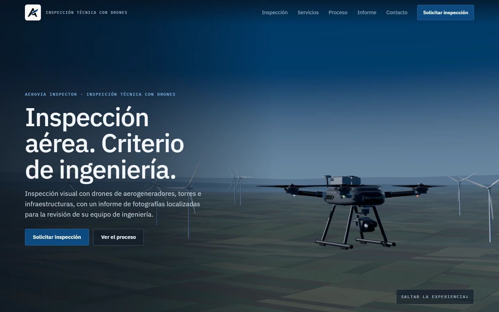
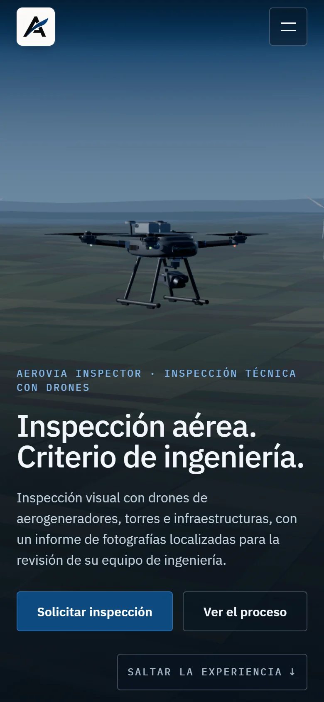

# AEROVIA INSPECTOR · demo web

Demo de una web para AEROVIA INSPECTOR, inspección técnica con drones. Primero hay un recorrido 3D en cuatro actos controlado por el scroll. Después vienen servicios, proceso, un ejemplo de informe y contacto.

Es una demo: no está publicada y no sustituye ni modifica la web actual del cliente.

| Escritorio (1440×900) | Móvil (390×844) |
| --- | --- |
|  |  |

Capturas de los cuatro actos en [docs/screenshots](docs/screenshots). Las decisiones de escena están en [docs/STORYBOARD.md](docs/STORYBOARD.md) y el origen de cada recurso en [ASSETS.md](ASSETS.md).

## Estado

### Terminado

- **Recorrido 3D.** Cuatro actos sobre una sola progresión de scroll, gestionada por GSAP ScrollTrigger, sin inercia ni suavizado. La escena es una función pura de la posición: avanza, retrocede y se detiene con el scroll.
- **Modelos.** Dron industrial genérico y aerogenerador de 120 m de rotor, modelados por código a escala real. Llevan materiales PBR, cielo de hora azul, un entorno de luz generado en el navegador y sombras. Al fondo hay un parque eólico sobre terreno agrícola.
- **Trayectoria sin colisiones.** Comprobada contra la geometría real de la turbina con la envolvente completa del dron, hélices incluidas, en 1.500 puntos. La distancia mínima es de 6,34 m, frente a los 5 m de separación de la demo. Ese valor es un parámetro de la demo, no una distancia reglamentaria.
- **Encuadres.** Uno para pantallas anchas y otro para verticales. Los textos son HTML y no tapan el dron, comprobado en el navegador en diez formatos.
- **Contenido.**
  - Servicios y proceso (planificación, captura, revisión, informe).
  - Ejemplo de informe rotulado como simulación.
  - Contacto con un formulario de demostración que dice claramente que no envía nada.
- **Accesibilidad.**
  - HTML semántico, enlace para saltar la experiencia y navegación con teclado con foco visible.
  - Contraste comprobado y objetivos táctiles de 44 px.
  - Sin texto cortado al 200 % de zoom.
- **Alternativa estática.** Imágenes de la misma escena con el mismo contenido. Se usa con movimiento reducido, sin WebGL, si se pierde el contexto, si falla la carga del 3D y en ventanas demasiado bajas.
- **Carga.**
  - Progresiva, con progreso real.
  - El 3D no bloquea el resto de la página.
  - El dibujo se pausa fuera de pantalla y con la pestaña oculta.
- **Integración continua.** Typecheck, tests y build en cada PR. El flujo de publicación en GitHub Pages está preparado, pero no se ha ejecutado.

### Provisional o pendiente del cliente

- **Modelos 3D procedurales.** Son creíbles en escala y proporciones, pero no fotorrealistas. Para dar ese paso hacen falta modelos y texturas con licencia (ver [ASSETS.md](ASSETS.md)).
- **Logo.** Falta una versión vectorial o PNG transparente. Mientras tanto se usa el PNG original sobre una placa clara de su mismo fondo.
- **Contacto.** No hay correo, teléfono ni destino del formulario: están pendientes de que AEROVIA los confirme. Se configuran en [src/content/site.ts](src/content/site.ts).
- **Textos.** Los de servicios y proceso se han redactado a partir de la web actual del cliente, sin cifras ni promesas. Necesitan su revisión.
- **Imagen para compartir.** Se genera desde la escena. Para que las redes la lean hace falta una URL absoluta (`SITE_URL`) al publicar.

## Ejecutar

Requisitos: Node 20 o posterior (probado con 24.21.0) y npm. Para las comprobaciones de navegador hace falta Chrome o Edge; `BROWSER=/ruta/al/navegador` permite elegir otro.

```bash
npm ci
npm run dev
npm run check
npm run build
npm run preview
npm run e2e
```

- `npm run dev`: desarrollo en http://localhost:5173/aerovia-inspector-demo/
- `npm run check`: typecheck, tests unitarios y build.
- `npm run build` y luego `npm run preview`: la build de producción en http://localhost:4174/aerovia-inspector-demo/
- `npm run e2e`: comprobaciones de navegador contra `preview`.

Otras herramientas (con `dev` o `preview` en marcha):

- `node e2e/perf.mjs`: peso transferido, tiempo hasta el primer fotograma 3D y fotogramas por segundo.
- `node e2e/doc-shots.mjs`: las capturas de `docs/screenshots`.
- `npm run stills`: vuelve a renderizar desde la escena las imágenes fijas de la versión estática, la captura del informe y la imagen para compartir.
- `node e2e/shots.mjs --ps=0.1,0.5`: capturas en cualquier punto del recorrido.

Parámetros de URL para revisar o renderizar:

| Parámetro | Efecto |
| --- | --- |
| `?still` | Sin movimiento ambiental (hélices y parque quietos) |
| `?p=0.63` | Progreso fijo, sin scroll |
| `?payload` | Lo que ve la cámara del dron |
| `?nowebgl` | Fuerza la versión estática |

## Estructura

```
src/
  content/site.ts       textos, servicios, proceso, informe de ejemplo y contacto (editable)
  components/           cabecera, experiencia 3D, versión estática, secciones y pie
  experience/
    config.ts           actos, separación de la demo, longitud del recorrido
    trajectory.ts       dron, gimbal y cámara como funciones puras del progreso
    world.ts            escena three.js: cielo, luces, terreno, turbina, parque eólico, dron
    Scene.tsx           lienzo de React Three Fiber y bucle de dibujo
    materials.ts        materiales PBR y texturas procedurales
    models/             dron, aerogenerador, paisaje y utilidades de geometría
  lib/                  scroll (único dueño), navegación, capacidades del navegador, imágenes fijas
  styles/               tokens de color y tipografía, base, página
tests/                  trayectoria (colisiones, encuadre, calma) y contenido (afirmaciones, contraste)
e2e/                    comprobaciones de navegador, rendimiento y capturas
scripts/                derivados del logo e imágenes fijas renderizadas
```

## Publicación (no realizada)

- **Base configurable.** La build usa la base `/aerovia-inspector-demo/` de GitHub Pages. `BASE_PATH` la cambia para otro alojamiento. `SITE_URL` (la dirección pública, cuando exista) añade URL absolutas a la imagen para compartir y a la etiqueta canonical.
- **Flujo de publicación.** [.github/workflows/deploy.yml](.github/workflows/deploy.yml) solo se ejecuta a mano (`workflow_dispatch`). Fusionar no publica nada.
- **Requisito previo.** El titular del repositorio debe activar GitHub Pages con la fuente «GitHub Actions».
- **Vercel.** No se toca: la web del cliente sigue como está.

## Pruebas realizadas

### Unitarias (`npm test`, 26 pruebas)

- **Trayectoria, contra la geometría real de la turbina y en 1.500 puntos:**
  - Separación de la envolvente del dron de al menos 5 m; el mínimo es 6,34 m, en p = 0,778.
  - Dron sobre el terreno, inclinación de 15° como máximo y gimbal apuntando a la pala.
  - Cámara a 2 m o más de la turbina; el mínimo es 17,1 m en ancho y 17,9 m en vertical. Nunca entra en el dron ni baja de 15 m sobre el suelo.
  - Dron en cuadro y sin oclusiones en los actos 1–3.
  - Cámara sin alabeo, con pasos de giro menores de 1,2° y un giro total de 101–102° (rango de 71–73°).
  - La misma imagen hacia delante y hacia atrás.
- **Contenido.** Sin las afirmaciones que excluye el brief (milimétrica, IA, 24 h, garantías, certificaciones, testimonios, termografía, LiDAR) y sin datos de contacto inventados. La simulación está rotulada y los CTA y anclas son los del brief.
- **Contraste WCAG** de los pares de color reales de la hoja de estilos: texto a 4,5:1 o más; foco y bordes de campo a 3:1 o más.

### En navegador (`npm run e2e`)

309 comprobaciones superadas contra la build de producción, en Edge sin interfaz.

- **Carga.**
  - Sin errores de consola ni recursos fallidos.
  - Imágenes correctas, enlaces internos con destino y ningún enlace externo.
  - Sin desbordamiento horizontal ni texto recortado; objetivos táctiles de 44 px en móvil.
- **Encuadre de los cuatro actos en diez formatos.** Probado en 1440×900, 1920×1080, 390×844, 1280×720, 1366×768, 1024×768, 768×1024, 375×667, 412×915 y 960×540. Se comprueba que:
  - Los textos están dentro de la pantalla y bajo la cabecera.
  - Ningún texto toca el contorno proyectado del dron (hélices incluidas) ni el botón de saltar.
  - Las etiquetas de la escena están dentro de la pantalla.
- **Scroll.** Con la rueda lenta, rápido adelante y atrás, y lento hacia atrás. En la misma posición se obtiene la misma imagen (0,00 px de diferencia), y la escena se detiene al detenerse el scroll.
- **Navegación.**
  - Anclas del menú, CTA, «Saltar la experiencia» y hash en la URL de llegada.
  - El primer Tab lleva al enlace de salto.
  - Menú móvil: cerrado y fuera del orden de tabulación; se cierra con Escape y con un enlace.
- **Teclado.** Foco visible en cada parada de tabulación, en escritorio y en móvil.
- **Formulario.**
  - Vacío no se acepta.
  - Relleno muestra «No se ha enviado nada» con el foco en el aviso.
  - No sale ninguna petición y la página no navega.
- **Alternativas.** Todas muestran la versión estática con las cuatro imágenes y sin texto cortado:
  - movimiento reducido;
  - `?nowebgl`;
  - ventanas bajas (720×450, que es 1440×900 al 200 %; 844×390; 960×480);
  - pérdida del contexto WebGL;
  - fallo al cargar el código 3D.
- **Pausa.** Hay llamadas de dibujo con la escena en pantalla, cero fuera de pantalla o con la pestaña oculta, y cero en reposo sin movimiento ambiental.
- **Redimensionado.** Al pasar de 1440 a 390, 1920, 1024 y de vuelta a 1440 se mantiene el encuadre y se recupera la misma imagen.

### Rendimiento (`node e2e/perf.mjs`)

**Método:**

- Build de producción servida en local con gzip y caché desactivada.
- Recorrido completo del scroll en 8 s, midiendo cada fotograma.
- En modo sin interfaz el navegador no limita los fotogramas a 60 Hz: más de 60 FPS indica margen.

**Equipo:** Intel Core i7-12650H, 16 GB. El navegador usó la gráfica integrada Intel UHD Graphics (ANGLE D3D11), no la RTX 3050 dedicada.

| Formato | Página sin el 3D | Código 3D | Total transferido | Primer fotograma 3D | Lienzo (px) | FPS medios | Fotograma p95 | Fotogramas > 50 ms |
|---|---|---|---|---|---|---|---|---|
| Escritorio 1440×900 | 275 KB | 249 KB | 524 KB | 3,5 s* | 1440×900 | 120 | 8,3 ms | 2 |
| Escritorio 1920×1080 | 268 KB | 249 KB | 518 KB | 1,2 s | 1920×1080 | 104 | 16,1 ms | 0 |
| Ventana móvil 390×844 @3x | 266 KB | 249 KB | 515 KB | 1,2 s | 585×1266 | 127 | 8,3 ms | 0 |
| Ventana móvil, CPU ×4 más lenta | 266 KB | 249 KB | 515 KB | 3,3 s | 585×1266 | 120 | 8,6 ms | 0 |
| Ventana móvil, CPU ×4 y red 4G simulada (9 Mbit/s, 150 ms) | 266 KB | 249 KB | 515 KB | 4,1 s | 585×1266 | 119 | 15,2 ms | 0 |

\* La primera fila incluye el arranque en frío del navegador.

En móvil el lienzo se limita a 1,5× la densidad de pantalla y se usa geometría más ligera.

**No probado:**

- Teléfonos reales (Safari en iOS, Chrome en Android), por lo que el objetivo de 30 FPS o más en móvil no está verificado en dispositivo.
- Firefox y Safari.
- Lectores de pantalla: solo se ha comprobado la estructura.
- La publicación en GitHub Pages.

## Límites conocidos

- **Realismo.** El dron y el aerogenerador son modelos procedurales genéricos, sin marca. Las texturas son generadas y no hay HDRI. El realismo se apoya en la escala, la luz y los materiales, no en efectos.
- **Ventanas bajas.** Por debajo de 540 px de alto (600 px en vertical) se muestra la versión estática: un móvil en horizontal o un portátil con mucho zoom no ven el 3D.
- **Simulaciones.** El defecto de la pala y el informe son simulaciones con datos de ejemplo, y así se rotulan en la página.
- **Tipografías.** Solo incluyen el subconjunto latino, suficiente para español.
