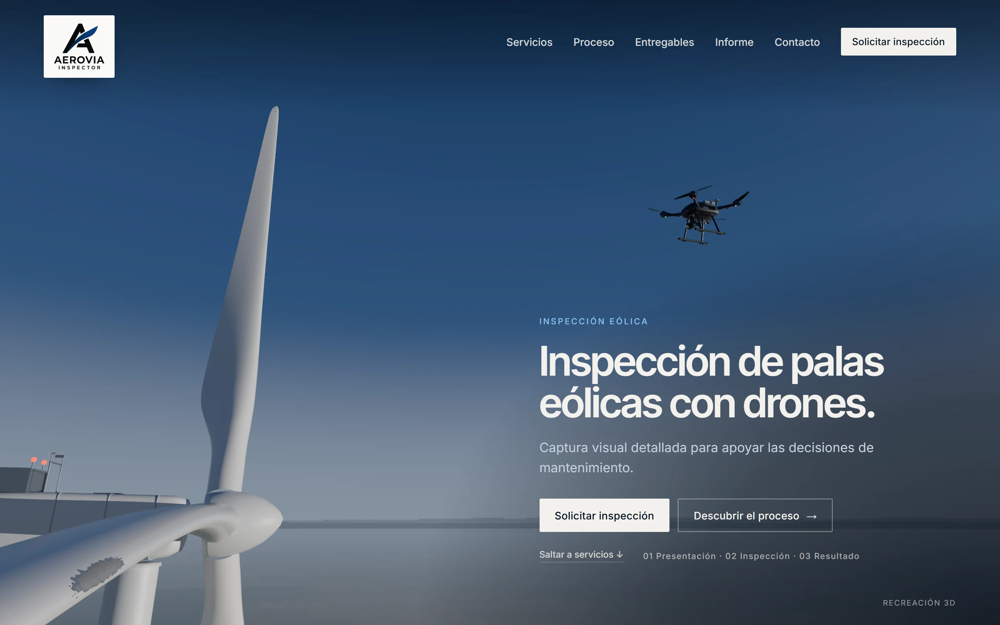
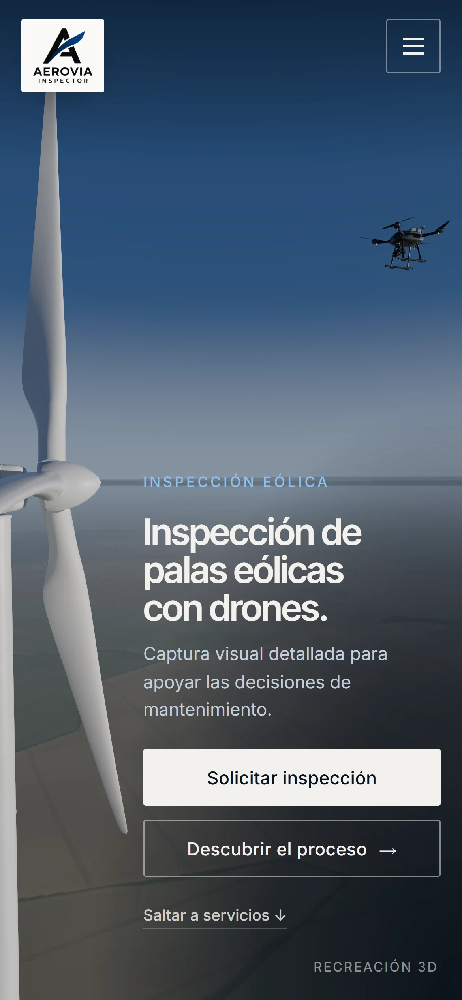
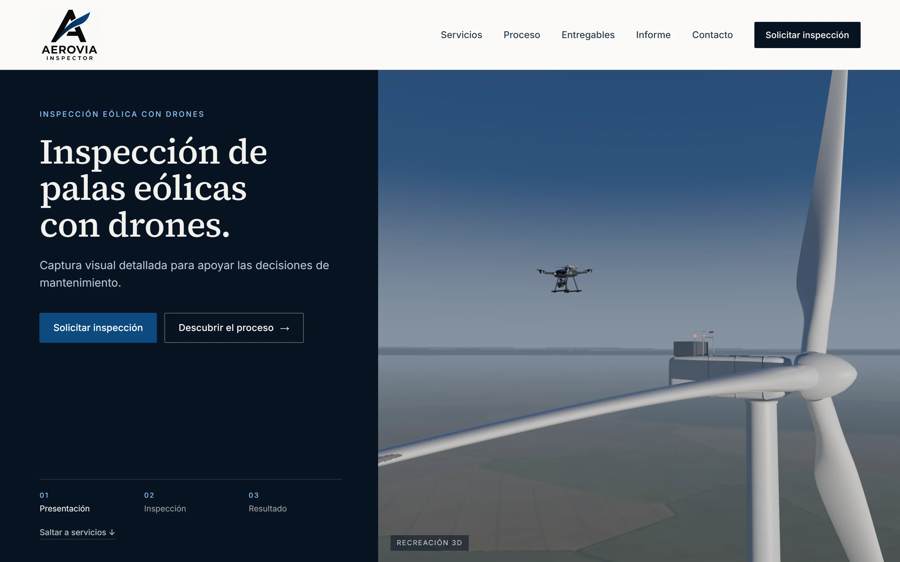
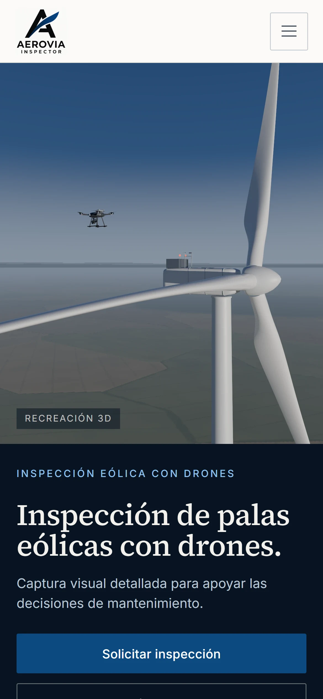

# Rediseño de la portada: dos direcciones para elegir

Primera entrega del rediseño: un análisis de la demo publicada y dos portadas de alta fidelidad, cada una en escritorio y en móvil. Todavía no se reconstruye la web; se hará con la dirección que se elija.

Las imágenes de las portadas son **renders reales de la escena 3D** del proyecto, hechos con trazado de rayos (*path tracing*), no ilustraciones ni fotomontajes. Lo que se ve es la calidad que se puede producir hoy con estos medios. Más abajo se indica qué recursos son provisionales y qué haría falta para subir el nivel.

## 1. Análisis de la demo actual

- **Paisaje artificial.**
  - La textura de campos se repite cada ~670 m y se lee como un mosaico.
  - Las 18 turbinas del fondo son idénticas y están en filas.
  - Todo junto da el aspecto de simulador del que habla el encargo.
- **Luz plana.** La iluminación en tiempo real no tiene reflejos ni sombras creíbles: el dron queda como una silueta oscura y las palas como tubos blancos sin materia.
- **Protagonismo perdido.**
  - En tres de los cuatro actos el dron ocupa menos del 5 % del ancho, y en uno hace falta un anillo para encontrarlo.
  - La portada no muestra ninguna pala: no se entiende a qué se dedica la empresa.
- **Composición sin intención.** El titular ocupa media pantalla sobre cielo vacío, el dron no tiene relación visual con una pala y la ficha final flota sobre el parque.
- **Discurso interno.** Frases como «sin promesas que no se puedan comprobar», la escala del modelo o la separación de la simulación son documentación, no venta.
- **Tipografía de herramienta.** IBM Plex con etiquetas monoespaciadas en mayúsculas por todas partes: parece una aplicación técnica, no una empresa de servicios.
- **Marca.** El logo apilado aparece pequeño en una placa blanca. Falta una versión horizontal y otra en negativo para fondos oscuros.

## 2. Propuesta A · Detalle industrial



| Móvil |
| --- |
|  |

- **Imagen.**
  - La cámara está a ras de la pala inspeccionada, junto al borde de ataque, con la zona de erosión en primer plano.
  - La pala corre hacia el buje y la góndola; el dron trabaja cerca, recortado contra el cielo.
  - El horizonte queda bajo, con bruma.
  - El protagonismo sale del encuadre y la perspectiva: el dron mide 0,9 m entre motores y se ve grande porque está cerca de la cámara, no porque se haya escalado.
- **Maqueta.**
  - Imagen a sangre, con el titular abajo a la derecha sobre cielo abierto y un degradado solo donde hay texto.
  - Ningún texto toca la pala ni el dron.
  - Logo original en su placa de color propio.
  - Inter Tight para titulares e Inter para el texto: precisa y técnica.
- **Cómo se animaría (tres momentos):**
  1. **Presentación.** La portada tal cual. Al empezar el scroll, la cámara se desliza despacio a lo largo del borde de ataque.
  2. **Inspección.** El dron avanza por la pala con separación constante y el gimbal mirando a la superficie. Al llegar a la zona de erosión aparece un marco de captura fino y una nota breve.
  3. **Resultado.** La imagen se recorta al encuadre de la cámara del dron y esa captura se coloca en la ficha del informe: activo, zona, imagen, observación y «pendiente de revisión profesional».

## 3. Propuesta B · Inspección en contexto



| Móvil |
| --- |
|  |

- **Imagen.**
  - Vista media del rotor detenido a la altura del buje: góndola, buje y las tres palas.
  - El dron trabaja delante, sobre la pala que inspecciona.
  - Al fondo, el paisaje y el horizonte con bruma.
  - Explica el servicio en un vistazo: qué se inspecciona, con qué y dónde.
- **Maqueta.**
  - Cabecera clara (blanco roto) con el logo sobre su color original.
  - Columna azul marino a la izquierda, con el titular en serif (Source Serif 4), los botones y un índice de los tres momentos.
  - Imagen a la derecha, enmarcada y sin texto encima.
  - En móvil, la imagen arriba y el texto debajo.
  - Tono editorial, de informe técnico.
- **Cómo se animaría (tres momentos):**
  1. **Presentación.** La portada tal cual; el índice marca «01».
  2. **Inspección.** La cámara se acerca al dron por detrás mientras recorre la pala, siempre fuera de la geometría. La columna cambia a «02», con un texto breve sobre la captura, y un marco fino señala la zona.
  3. **Resultado.** La imagen pasa a ser la captura, y la columna izquierda se convierte en la ficha del informe («03»).

## 4. Implementación propuesta (para cualquiera de las dos)

- **Recomendación: secuencia prerenderizada.**
  - Fotogramas renderizados con el mismo motor que estas imágenes, unos 120 por formato (horizontal y vertical).
  - Se dibujan en un `<canvas>` según el scroll, así que avanza, retrocede y se para con él.
  - Funciona igual de fluido en móvil, porque solo decodifica imágenes.
- **Peso estimado.** Entre 6 y 12 MB por formato en WebP o AVIF, con carga progresiva: primero el fotograma de portada, después uno de cada cuatro y luego el resto.
  - La portada y el contacto no esperan a la secuencia.
- **Tiempo de render.** En este equipo (RTX 3050 de portátil) se ha medido una velocidad de unos 9 millones de muestras por segundo: 2560×1600 a 128 muestras en 58 s.
  - Cada fotograma de 1600×1000 a 256 muestras costaría unos 45 s: alrededor de 1,5 h por formato y 3 h los dos.
  - Se lanza de una vez y no requiere intervención.
- **Alternativa en tiempo real.** WebGL con la luz precalculada: más ligero, pero visiblemente menos realista que estas imágenes.
- **Movimiento reducido y fallo del 3D.** La versión estática se construye con los mismos fotogramas clave.
- **Lo que se conserva de la base actual.** El gestor único del scroll, la trayectoria del dron con comprobación de colisiones, las pruebas, la accesibilidad, la estructura de contenidos y el despliegue.

## 5. Recursos: definitivos, provisionales y lo que falta

| Recurso | Estado | Nota |
| --- | --- | --- |
| Geometría de pala y aerogenerador | Válida, mejorable | Perfil aerodinámico, cuerda, torsión y escala reales (rotor de 120 m); falta detalle de superficie a muy corta distancia |
| Material de la pala | Provisional | Gelcoat procedural con brillo y textura fina |
| Dron | Provisional | Modelo procedural con óptica, gimbal, motores y tren de aterrizaje; creíble a media distancia, no para primeros planos |
| Cielo | Provisional | Gradiente procedural de tarde, limpio pero sin nubes |
| Paisaje | Provisional | Procedural con bruma; solo funciona lejos y con el horizonte bajo |
| Motor de render | Definitivo | three-gpu-pathtracer (MIT) sobre WebGPU |
| Tipografías | Definitivas | Inter, Inter Tight y Source Serif 4 (SIL OFL 1.1) |
| Logo | Original, sin tocar | Falta versión horizontal y en negativo (SVG o PNG transparente) |

### Lista concreta de lo que falta (nada se ha descargado ni comprado)

1. **Cielo real (HDRI).**
   - **Recurso:** «Evening Road 01 (Pure Sky)» de Poly Haven, licencia CC0, `evening_road_01_puresky_4k.hdr` (18,7 MB).
   - **Alternativa:** «Belfast Sunset (Pure Sky)», `belfast_sunset_puresky_4k.hdr` (17,4 MB).
   - **Qué aporta:** nubes y luz reales, y reflejos verdaderos en la pala y el dron.
   - **Pendiente:** tu permiso para descargarlo.
2. **Modelo de dron con licencia.**
   - **Opción a:** el modelo o el CAD del dron que use AEROVIA. Es lo más honesto, porque se mostraría su equipo real.
   - **Opción b:** un modelo CC BY de Sketchfab. Descargarlo exige una cuenta: tendrías que bajarlo tú.
   - **Opción c:** una compra. Por ejemplo, en CGTrader hay un dron industrial X8 en glTF por 42,99 $ con licencia *Royalty Free*. Solo se haría con tu autorización.
3. **Paisaje real (si la dirección elegida enseña el suelo de cerca).**
   - **Recurso:** ortofoto del PNOA (IGN/CNIG), licencia equivalente a CC BY 4.0 con mención del IGN, a 25–50 cm/píxel, de una zona agrícola.
   - **Pendiente:** el Centro de Descargas pide aceptar sus condiciones, así que necesita tu permiso o que lo descargues tú.
4. **Logo en SVG o PNG transparente, con versión en negativo.** Lo tiene que facilitar AEROVIA.

## 6. Cómo se han hecho y cómo reproducirlas

- **Escena.** [propuestas/scene.ts](../../propuestas/scene.ts):
  - El aerogenerador y el dron de la base, con el material de la pala para planos cercanos.
  - Sin terreno cuadriculado ni parque eólico repetido.
  - El cielo, el paisaje lejano y la bruma son un mapa HDR generado en [propuestas/sky.ts](../../propuestas/sky.ts).
- **Render.** [propuestas/render-gpu.ts](../../propuestas/render-gpu.ts), trazado de rayos con three-gpu-pathtracer sobre WebGPU. Lo lanza [scripts/render-propuestas.mjs](../../scripts/render-propuestas.mjs) con `npm run dev` en marcha:

  ```bash
  node scripts/render-propuestas.mjs --w=2560 --h=1600 --spp=384 --cam=-49.93,99.84,8.67 --aim=0.70,0.34 --fov=52 --out=docs/propuestas/render/a-escritorio.webp
  node scripts/render-propuestas.mjs --w=1170 --h=2532 --spp=384 --cam=-51.2,100.2,9.2 --aim=0.88,0.24 --fov=82 --out=docs/propuestas/render/a-movil.webp
  node scripts/render-propuestas.mjs --w=1800 --h=1800 --spp=384 --cam=-51.8,102.1,20.3 --aim=0.36,0.42 --fov=50 --out=docs/propuestas/render/b-escritorio.webp
  node scripts/render-propuestas.mjs --w=1170 --h=1380 --spp=384 --cam=-51.8,102.1,20.3 --aim=0.30,0.40 --fov=56 --out=docs/propuestas/render/b-movil.webp
  ```

  `aim` coloca el dron en ese punto de la pantalla (0–1 desde la izquierda y desde arriba).
- **Encuadres.** Se eligieron con previsualizaciones rápidas ([scripts/propuestas-candidatos.mjs](../../scripts/propuestas-candidatos.mjs)) y con un buscador de cámara ([propuestas/solve.ts](../../propuestas/solve.ts)) que coloca el dron y puntos de la pala donde pide la maqueta.
- **Maquetas.** [propuestas/portada-a.html](../../propuestas/portada-a.html) y [propuestas/portada-b.html](../../propuestas/portada-b.html). Las capturas salen de [scripts/propuestas-capturas.mjs](../../scripts/propuestas-capturas.mjs).
- **Alcance.** Nada de esto forma parte todavía de la web publicada: la build de producción no cambia.

## 7. Qué no se promete

- Que la web final sea idéntica fotograma a fotograma: el movimiento añade restricciones de cámara, separación y colisiones, que se comprobarán como hasta ahora.
- Fotorrealismo del dron en primer plano sin un modelo con licencia.
- Ninguna capacidad, cifra, cliente ni certificación: los textos de servicio se redactarán con lo que AEROVIA confirme.
