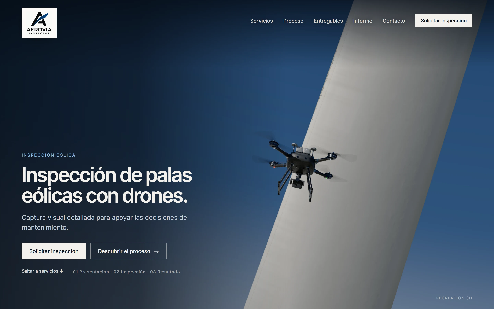
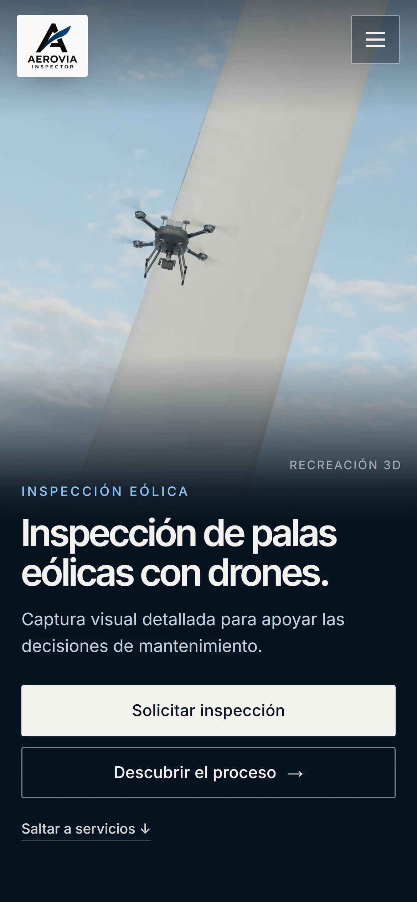
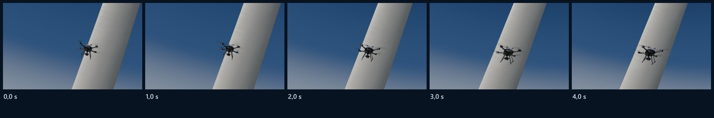

# Propuesta A revisada: portada y prueba de movimiento

Segunda entrega de la dirección A. Antes de producir la animación completa, hay que aprobar una imagen convincente y comprobar que se sostiene en movimiento. Aquí están la portada revisada (escritorio y móvil) y una prueba corta de movimiento. No se ha reconstruido ni publicado la web, no se ha comprado nada y no se ha descargado ningún recurso.

Las imágenes son **renders de la escena 3D** del proyecto con trazado de rayos, no fotomontajes.

## 1. Portada revisada



| Móvil |
| --- |
|  |

Renders sin maqueta: [escritorio, 2560×1600](render/a2-escritorio.webp) · [móvil, 1170×1462](render/a2-movil.webp). Los dos a 384 muestras por píxel, en 137 s y 69 s en una RTX 3050 de portátil.

### Los cinco ajustes pedidos

| Ajuste | Qué se ha hecho |
| --- | --- |
| **Menos cielo vacío, composición más intencionada** | El cuadro se ordena en tres franjas: el texto a la izquierda, el dron en el centro y la pala a la derecha, cruzando todo el alto en diagonal. El cielo que queda es el fondo del texto, no espacio sobrante. El encuadre se buscó con una herramienta que puntúa la superficie de pala en cuadro, la zona libre para el texto, la ausencia de suelo y el tamaño del dron ([propuestas/compose.ts](../../propuestas/compose.ts)). |
| **La pala domina y muestra su superficie y su borde de ataque** | La cámara mira la cara iluminada de la pala superior. La pala es el elemento más grande del cuadro y el borde de ataque corre a lo largo de su lado izquierdo, con la línea de la cinta de protección visible. |
| **El dron se reconoce por perspectiva, encuadre e iluminación, sin cambiar su escala** | El dron mantiene su escala real (0,9 m entre motores). Está a unos 4,5 m de la pala y a 8 m de la cámara, así que la perspectiva lo hace ocupar en torno al 20 % del ancho. Se ve en tres cuartos, desde algo más abajo, con la silueta oscura mitad sobre la pala blanca y mitad sobre el cielo. La luz lateral marca brazos, motores y gimbal. Las hélices llevan el desenfoque de giro que captaría un obturador rápido. |
| **Materiales menos lisos y artificiales** | La pala tiene una superficie nueva en medidas reales: cinta de protección de 14 cm a cada lado del borde de ataque con los bordes sucios, restos de insectos y picado de lluvia en el borde hacia la punta, suciedad arrastrada a lo largo de la cuerda, reparaciones lijadas, suciedad en el borde de salida, variaciones de brillo y relieve milimétrico. La erosión de ejemplo tiene relieve: el recubrimiento gastado deja ver la masilla y el laminado, con picaduras alrededor ([propuestas/surfaces.ts](../../propuestas/surfaces.ts)). |
| **Móvil con composición propia y legible** | El móvil tiene su propio encuadre vertical del mismo momento, con la pala en diagonal y el dron en el centro. El texto ya no va sobre la imagen: va debajo, sobre azul marino y a todo el ancho, con titular de 36–40 px y botones a ancho completo. Sobre la imagen solo quedan el logo y el menú. |

### Dirección de luz y color

Sol de media tarde a unos 30° de altura, desde barlovento y por encima del dron. Ilumina de lleno el borde de ataque y deja la cara de la pala en degradado hacia el borde de salida, lo que da volumen. El cielo va del azul marino profundo arriba al gris azulado con bruma abajo, y encaja con la paleta: marino, blanco roto y acentos azules contenidos.

## 2. Prueba de movimiento

[prueba-movimiento-a.webm](movimiento/prueba-movimiento-a.webm): 4 s hacia delante y la misma secuencia hacia atrás, como al bajar y subir con el scroll.



- **Qué ocurre.**
  - Parte del encuadre de portada.
  - La cámara se acerca y gira unos 18° hacia barlovento.
  - El dron sube 1,4 m a lo largo de la pala hacia la zona gastada, sin acercarse a menos de 3,8 m de la superficie.
  - El gimbal no se separa del detalle.
  - Las hélices giran: cada fotograma las captura en una posición distinta, como haría una cámara real.
- **Qué permite valorar.**
  - **Profundidad.** El dron, cerca de la cámara, se desplaza en el cuadro menos que la pala, que está detrás.
  - **Materiales.** La luz sobre la pala cambia al cambiar el ángulo: brillo, cinta y suciedad.
  - **Continuidad.** Sin saltos ni cortes, sin intersecciones y con la misma luz en todos los fotogramas.
- **Cómo se ha hecho.**
  - 96 fotogramas a 1280×800 y 128 muestras por píxel, con el mismo motor y la misma escena que la portada.
  - Entre 15 y 38 s por fotograma (unos 34 minutos en total) en la RTX 3050 del portátil.
  - El vídeo es WebM (VP9) de 5,7 MB: medio segundo de pausa en cada extremo y 9,4 s en total.
- **Comprobación de continuidad.**
  - Se midió la diferencia entre cada fotograma y el siguiente.
  - Sigue una curva suave: crece al arrancar, alcanza su máximo a mitad del movimiento y baja al frenar. No hay picos, es decir, no hay saltos ni fotogramas sueltos.
  - Donde la cámara casi está quieta, la diferencia es mínima, así que el grano no parpadea de forma apreciable.
- **Límites conocidos.**
  - Queda algo de grano fino, propio de las muestras por fotograma; en la producción final se usarían más muestras.
  - El cielo sigue siendo procedural (ver el HDRI más abajo).

## 3. Cielo: el HDRI que usaría

- **Recurso:** «Evening Road 01 (Pure Sky)», de Poly Haven. Autores: Sergej Majboroda (original) y Jarod Guest (retoque del cielo).
- **Archivo:** `evening_road_01_puresky_4k.hdr`, 18 692 813 bytes (18,7 MB).
  - Origen: `https://dl.polyhaven.org/file/ph-assets/HDRIs/hdr/4k/evening_road_01_puresky_4k.hdr`.
  - Existe una versión de 2K (4 989 873 bytes) que basta para la iluminación.
- **Licencia, verificada el 15/10/2026 en polyhaven.com/license:** CC0.
  - Uso para cualquier fin, también comercial.
  - Sin obligación de atribución.
  - Redistribución permitida.
  - Se puede incluir en un producto que se venda.
  - El CC0 cubre los recursos, no los logos ni los textos del sitio de Poly Haven.
- **Por qué este.**
  - Cielo de tarde parcialmente nuboso.
  - Es la versión *pure sky*, sin suelo, que es lo que pide esta dirección (no hace falta suelo cercano).
  - Su luz baja y suave da reflejos reales en la pala y el dron, y las nubes quitan la sensación de cielo de estudio.
- **Estado:** no descargado. Necesito tu permiso para descargarlo.

## 4. Pendiente del cliente

- **Fotos o modelo del dron de AEROVIA.** El dron actual es un modelo procedural genérico. Con fotos se ajustarían proporciones, colores y detalles; con un modelo (CAD, glTF u OBJ) se sustituiría directamente.
- **Logo original en vectorial (SVG o PDF), con versión en negativo si existe.** En la maqueta va el logo actual en su placa clara.

## 5. Recursos: definitivos y provisionales

| Recurso | Estado | Nota |
| --- | --- | --- |
| Geometría de pala y aerogenerador | Válida | Perfil, cuerda, torsión y escala reales (rotor de 120 m) |
| Superficie de la pala | Nueva, provisional | Procedural en medidas reales; se afinará con fotos de palas reales si las hay |
| Erosión de ejemplo | Nueva, provisional | Ilustrativa; no representa ningún daño real |
| Dron | Provisional | Genérico, a sustituir por el del cliente |
| Cielo | Provisional | Procedural; el HDRI de arriba lo sustituiría |
| Motor de render | Definitivo | three-gpu-pathtracer (MIT) sobre WebGPU |
| Tipografías | Definitivas | Inter e Inter Tight (SIL OFL 1.1) |
| Logo | Original, sin tocar | Falta el vectorial |

## 6. Cómo reproducirlo

Con `npm run dev` en marcha:

```bash
node scripts/render-propuestas.mjs --w=2560 --h=1600 --spp=384 --cam=30.5,129.17,6.21 --aim=0.609,0.533 --roll=14 --fov=24 --hover=A:38.04,-1.27,0.62,auto,40.1,0.47,4.45 --sun=0.35,0.5,0.8 --out=docs/propuestas/render/a2-escritorio.webp
node scripts/render-propuestas.mjs --w=1170 --h=1462 --spp=384 --cam=30.11,128.58,6.31 --aim=0.411,0.463 --roll=10.2 --fov=34.3 --hover=A:38.04,-1.27,0.62,auto,40.1,0.47,4.45 --sun=0.35,0.5,0.8 --out=docs/propuestas/render/a2-movil.webp
node scripts/propuestas-capturas.mjs a2
node scripts/render-secuencia.mjs --frames=96 --w=1280 --h=800 --spp=128
node scripts/encode-video.mjs e2e/out/secuencia docs/propuestas/movimiento/prueba-movimiento-a.webm --fps=24 --pingpong --hold=12
```

- **Movimiento.** Los fotogramas clave están en [propuestas/motion.ts](../../propuestas/motion.ts) y el render fotograma a fotograma en [propuestas/sequence.ts](../../propuestas/sequence.ts). La escena se construye una vez; entre fotogramas solo cambian las posiciones del dron y la cámara.
- **Maqueta.** [propuestas/portada-a2.html](../../propuestas/portada-a2.html). La primera versión se conserva en [portada-a.html](../../propuestas/portada-a.html).
- **Alcance.** Nada de esto entra todavía en la web publicada: la build de producción no cambia.
