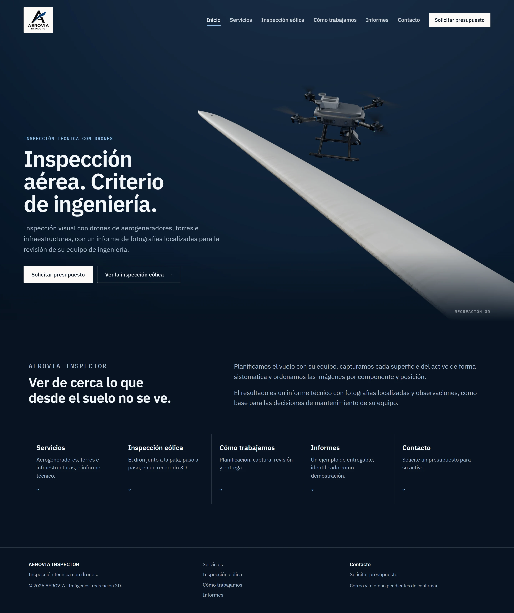
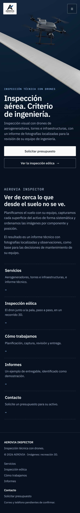
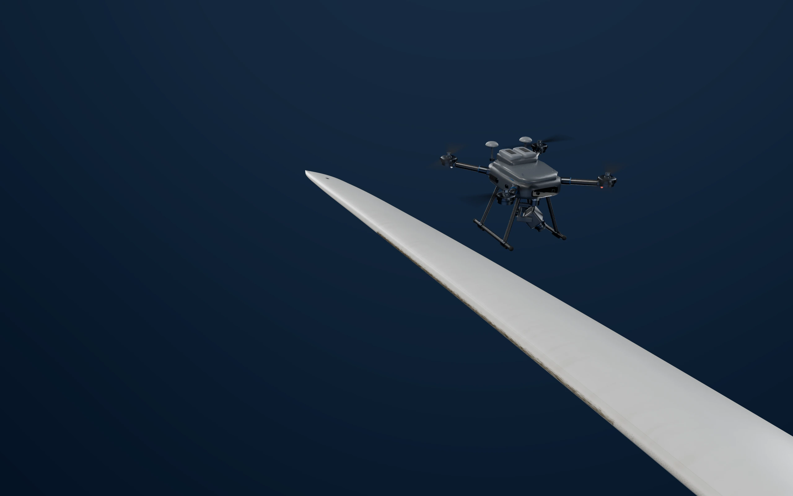
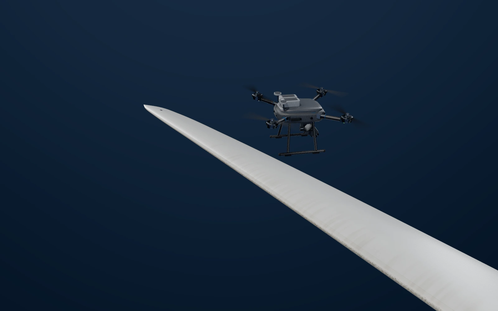
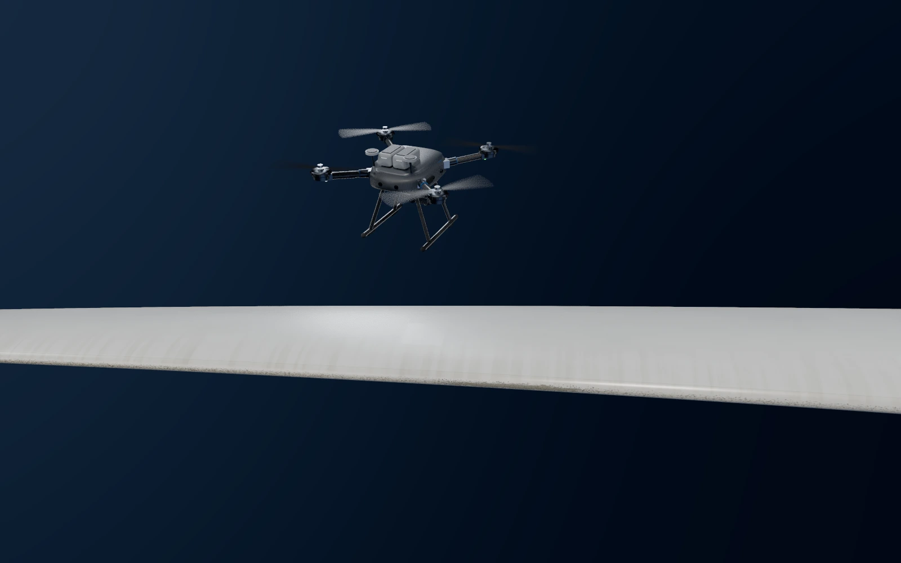
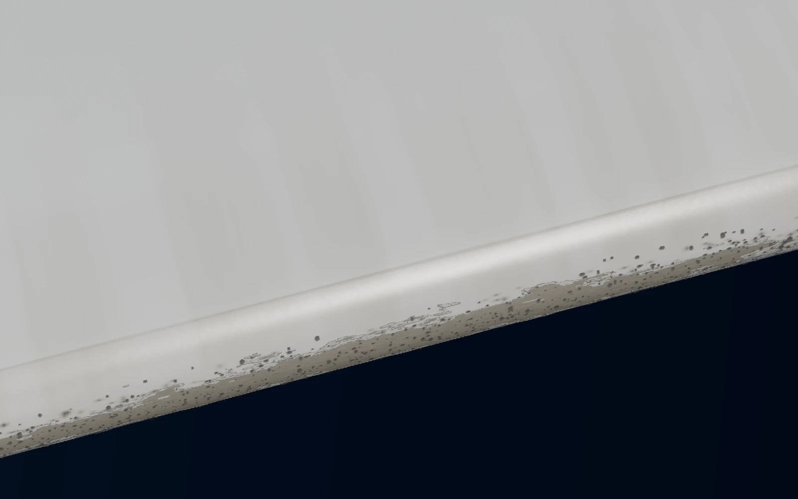
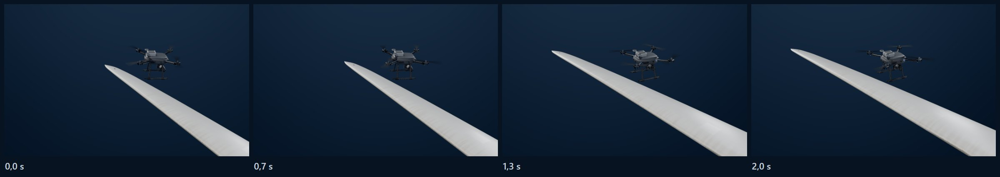

# AEROVIA INSPECTOR: web multipágina, propuesta visual

> **Revisión 2 (20/10/2026):** dron y pala mejorados, momento 3 como acercamiento real, accesos de Inicio con más presencia y las seis páginas construidas. Ver [revision-2.md](revision-2.md). Lo que sigue es la primera entrega, tal como se presentó.

Primera entrega de la nueva dirección: un dron y un tramo de pala sobre fondo azul marino de estudio, y una web con páginas independientes. **Es una propuesta para aprobar.** Todavía no se han reconstruido las páginas ni se ha producido la secuencia larga. Todo está en la rama `feature/aerovia-multipagina`: no se ha fusionado ni publicado nada, y no se ha tocado Aerflora ni la web original del cliente.

Las imágenes son renders con trazado de rayos de la escena 3D del proyecto, no fotomontajes.

## 1. Inicio



| Móvil |
| --- |
|  |

- **Portada.**
  - El dron y un tramo cercano de la pala, sobre azul marino de estudio.
  - En escritorio, el texto ocupa el azul libre a la izquierda.
  - En móvil hay un encuadre vertical propio: la pala cruza la mitad superior y el texto va en la mitad inferior, que en la imagen es azul liso. No es un recorte del escritorio.
  - Movimiento discreto: un acercamiento lento de la imagen, que se desactiva con movimiento reducido. En la versión final puede sustituirse por un bucle corto prerenderizado (hélices y una deriva mínima del dron).
- **Presentación breve.** Qué hace la empresa y qué entrega, en dos frases.
- **Accesos.** Una entrada a cada página, con su contenido en una línea.
- **Cabecera y pie comunes.**
  - El menú abre páginas, no anclas.
  - La página actual se marca.
  - Botón «Solicitar presupuesto».
  - En el pie, el aviso de que el correo y el teléfono están pendientes de confirmar.
- **Tipografía y color.**
  - IBM Plex Sans para titulares y texto, e IBM Plex Mono solo en etiquetas pequeñas. Las dos tienen licencia OFL y ya estaban en el proyecto.
  - Azul marino #071321, superficies #0D2034, azul #0C4A80 y blanco roto para los botones.
- **Textos.** Salen del contenido ya confirmado de la demo: servicios tomados de la web actual del cliente y proceso de cuatro pasos. No hay cifras, clientes, certificaciones ni capacidades nuevas.

Maqueta: [propuestas/inicio.html](../../propuestas/inicio.html).

## 2. Inspección eólica: los tres momentos

| 1 · Presentación cercana | 2 · Recorrido por la superficie |
| --- | --- |
|  |  |

| 3 · Acercamiento al detalle | Captura de la cámara del dron |
| --- | --- |
|  |  |

**Muestra de movimiento del momento 2:** [recorrido.webm](movimiento/recorrido.webm), 48 fotogramas a 1280×800, hacia delante y hacia atrás.



1. **Presentación cercana.** El mismo encuadre de la portada: el dron a unos 4,3 m del borde de ataque, con el gimbal orientado a la pala.
2. **Recorrido.**
   - El dron avanza a lo largo de la pala, de 50 m a 44,6 m del buje, con separación constante.
   - Su cámara mira el borde de ataque un poco por delante.
   - La cámara del plano le acompaña de lado, así que la superficie de la pala pasa por debajo: sin giros, sin órbitas y sin alejarse.
3. **Detalle.**
   - La cámara baja hacia la zona erosionada, con el dron todavía en cuadro.
   - La captura de su cámara (la última imagen) pasa a la ficha del informe de ejemplo, identificada como demostración.
   - Esa transición se hace en HTML sobre la imagen; no se rasteriza texto.

**Cómo se haría:**
- Una secuencia prerenderizada que el scroll dibuja en un `<canvas>`, así que avanza, retrocede y se para con él.
- Un juego de fotogramas por formato: horizontal para escritorio y vertical para móvil, con su propio encuadre.
- Los textos van en HTML, fuera de la zona del dron y de la pala.
- **Movimiento reducido:** los fotogramas clave estáticos, con el mismo contenido.
- **Por qué prerenderizado y no 3D en tiempo real:** la luz de estudio, los reflejos y las sombras de estas imágenes no se consiguen en tiempo real con la misma calidad. Además, en móvil solo hay que decodificar imágenes.
- **Coste estimado tras la aprobación:** unos 150–200 fotogramas por formato a 1600×1000 (y en vertical para móvil), a 12–20 s por fotograma en la RTX 3050 del portátil. Son una o dos horas por formato, sin intervención.

## 3. Estructura del sitio

| Página | Ruta en GitHub Pages | Contenido |
| --- | --- | --- |
| Inicio | `/aerovia-inspector-demo/` | Portada, presentación y accesos |
| Servicios | `/aerovia-inspector-demo/servicios/` | Aerogeneradores, torres e infraestructuras, e informe técnico, con el texto confirmado |
| Inspección eólica | `/aerovia-inspector-demo/inspeccion-eolica/` | El recorrido 3D de tres momentos |
| Cómo trabajamos | `/aerovia-inspector-demo/como-trabajamos/` | Planificación, captura, revisión y entrega |
| Informes | `/aerovia-inspector-demo/informes/` | Un entregable de ejemplo, marcado como demostración |
| Contacto | `/aerovia-inspector-demo/contacto/` | Solicitud de presupuesto y datos de contacto, cuando estén confirmados |

- **Rutas reales.**
  - Cada página es un HTML propio en su carpeta: una build multipágina de Vite.
  - Así, un enlace directo, recargar una página interior o usar atrás y adelante funcionan en GitHub Pages sin redirecciones.
  - Las rutas de recursos usan la base `/aerovia-inspector-demo/`, que sigue siendo configurable.
- **Componentes comunes.** La cabecera, la navegación y el pie se comparten. El contenido sigue en un único archivo de configuración editable.
- **Contacto sin destino configurado.** No habrá un formulario que parezca enviar. La página explicará qué datos conviene incluir en la solicitud y mostrará el correo y el teléfono cuando AEROVIA los confirme. Con un correo confirmado, el botón puede abrir un mensaje ya rellenado. Si se quiere un formulario, hará falta un destino real (un servicio de formularios o un servidor).

## 4. Recursos: definitivos y provisionales

| Recurso | Estado | Nota |
| --- | --- | --- |
| Geometría de la pala | Válida | Perfil, cuerda, torsión y escala reales de una pala de 58 m; se muestra un tramo |
| Superficie de la pala | Provisional (buena) | Procedural en medidas reales: cinta de protección, suciedad, picado y erosión con relieve |
| Luz de estudio y fondo | Definitivos | Generados en código ([propuestas/studio.ts](../../propuestas/studio.ts)), sin descargas |
| Desenfoque de hélices | Definitivo | Disco con la densidad de barrido de las palas reales (1/1000 s) |
| Dron | **Provisional** | Modelo procedural genérico: correcto en escala y piezas, pero no es un acabado final |
| Tipografía | Definitiva | IBM Plex Sans y Mono (SIL OFL 1.1) |
| Logo | Provisional | Raster sobre placa clara; falta el vectorial |
| Textos de servicios y proceso | Confirmados | De la web actual del cliente y de la demo aprobada |
| Correo y teléfono | Pendientes | AEROVIA debe confirmarlos |
| HDRI CC0 de la entrega anterior | Sin uso aquí | En esta dirección no se ve el cielo; podría servir solo para reflejos |

### El dron: qué hace falta

El dron es el recurso que más condiciona el realismo. Hay dos opciones:

1. **El dron de AEROVIA.**
   - Lo mejor sería su modelo (CAD, glTF u OBJ) o un juego de fotos: frente, lateral, arriba, gimbal y sensores, con permiso.
   - Con eso se modela o se importa su equipo real.
   - Sin referencias no se reproduce ningún dron comercial concreto.
2. **Un modelo genérico con licencia.**
   - Formato glTF/GLB con materiales PBR y texturas de 2–4K.
   - Licencia CC0, o CC BY 4.0 con la atribución en ASSETS.md.
   - En Sketchfab descargarlo exige una cuenta, así que tendrías que bajarlo tú.
   - Uno de pago solo con tu autorización. No se ha comprado nada.

Mientras tanto se usa el dron procedural, presentado como provisional.

## 5. Herramientas nuevas

- [propuestas/studio.ts](../../propuestas/studio.ts): la luz y el fondo de estudio.
- `studio=1` en las páginas de render: solo la pala inspeccionada y el dron.
- [propuestas/views.ts](../../propuestas/views.ts) y [scripts/propuestas-vistas.mjs](../../scripts/propuestas-vistas.mjs): muchas vistas rápidas de la escena, construida una sola vez, para elegir encuadres.
- [propuestas/motion-studio.ts](../../propuestas/motion-studio.ts): el recorrido del momento 2.

```bash
node scripts/render-propuestas.mjs --studio=1 --exp=0.9 --w=2560 --h=1600 --spp=384 --hover=B:46,3.6,2.4,auto,44,0.47 --camAround=55,20,3.6 --aim=0.66,0.36 --fov=44 --out=docs/rediseno-web/render/inicio-escritorio.webp
node scripts/render-propuestas.mjs --studio=1 --exp=0.9 --w=1170 --h=2340 --spp=384 --hover=B:46,3.6,2.4,auto,44,0.47 --camAround=45,22,3.3 --aim=0.58,0.28 --fov=58 --roll=6 --out=docs/rediseno-web/render/inicio-movil.webp
node scripts/render-secuencia.mjs --studio=1 --motion=studio --exp=0.9 --frames=48 --w=1280 --h=800 --spp=128 --out=e2e/out/secuencia-estudio
node scripts/propuestas-capturas.mjs --page=inicio --dir=docs/rediseno-web --full
```

## 6. Después de la aprobación

1. Construir las seis páginas con rutas reales, cabecera, navegación y pie comunes.
2. Producir la secuencia de Inspección eólica en los dos formatos y la versión estática.
3. Verificar:
   - enlaces directos, recargas y atrás y adelante en la ruta de GitHub Pages;
   - accesibilidad básica: teclado, foco, contraste y zoom al 200 %;
   - peso y carga de recursos;
   - ausencia de intersecciones en todo el recorrido.
4. Documentar los cambios en la PR, sin fusionar ni publicar hasta tu autorización.
