# Revisión 2: dron, pala, momento 3, accesos y las seis páginas

Respuesta a la revisión de la propuesta visual: se mantienen el fondo azul marino, el dron con la pala y la estructura multipágina. Todo sigue en la rama `feature/aerovia-multipagina` (PR en borrador): **no se ha fusionado ni publicado nada**, no se ha producido la secuencia larga y no se ha tocado Aerflora ni la web original del cliente.

## 1. Para aprobar antes de renderizar la secuencia

### El dron, mejorado

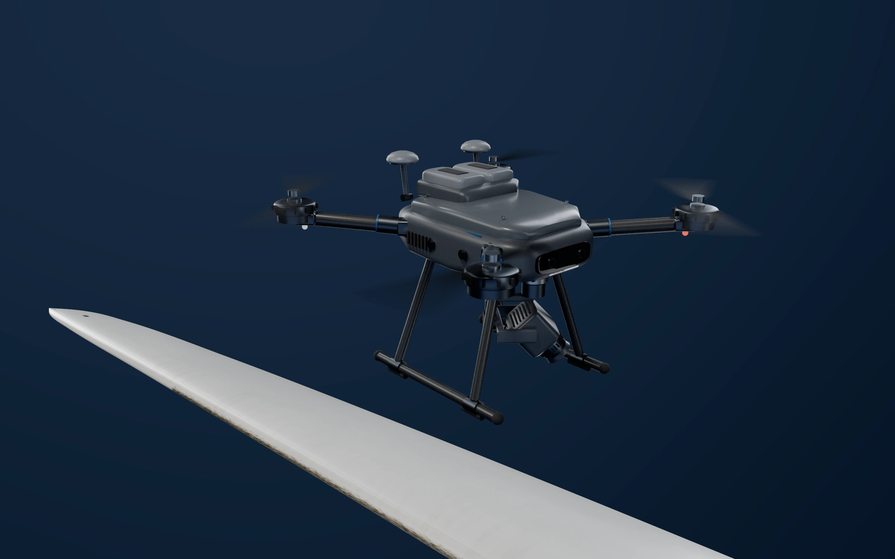

- **Baterías integradas.** Una bahía elevada en la carcasa con dos baterías redondeadas, cada una con asa de goma, cierre azul e indicador de carga. Antes eran dos bloques claros añadidos encima.
- **Antenas RTK** en cúpula, sobre mástiles plegables con su bisagra.
- **Piezas mecanizadas.** Bisagras de los brazos con pasador visible, abrazaderas de motor y anclajes del tren con aristas redondeadas, casquillos donde las patas se unen a los patines y brazos del gimbal redondeados.
- **Acabado.** Menos grano en las carcasas y un desenfoque de hélices con brillo suave, sin manchas claras.
- **Encuadre.** Las patas quedan separadas de la pala en la imagen: antes parecían apoyadas sobre ella.
- **Sigue siendo provisional.** Es el modelo procedural del proyecto, más cuidado, no el modelo definitivo (ver el apartado 5).

### El detalle de la inspección (momento 3)

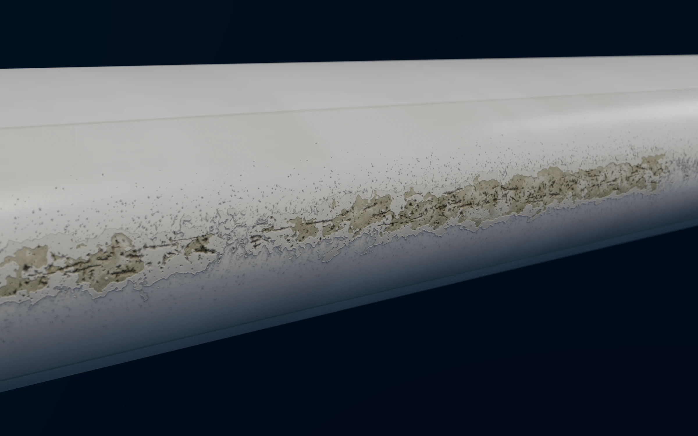

Un acercamiento real a unos 0,8 m del borde de ataque, de frente, con profundidad de campo de cámara (f/8): se ve qué hay y dónde está, no otro plano general.

- **Erosión rehecha, con texturas de medio milímetro por texel.** Las capas se desgastan como en una pala real: el recubrimiento se desconcha en islas irregulares y deja ver la masilla gris y, donde es peor, el laminado de fibra de vidrio. Hay picaduras de todos los tamaños, más densas hacia la línea de impacto, surcos a lo largo de la envergadura y un halo mate alrededor.
- **Superficie de la pala.** La suciedad del borde de ataque en los planos generales es ahora más contenida.
- **La captura de la cámara del dron**, de frente y con teleobjetivo, es la imagen que pasa al informe de ejemplo, con la zona observada marcada:

## 2. Inicio: accesos con más presencia

| Escritorio | Móvil |
| --- | --- |
|  |  |

- **Portada.** La aprobada, con el dron mejorado.
- **Accesos.** Antes eran una fila de enlaces. Ahora hay:
  - una tarjeta destacada con imagen para la inspección eólica;
  - tres tarjetas para Servicios, Cómo trabajamos e Informes, con imagen o con las cuatro fases;
  - una banda final para solicitar presupuesto.

## 3. Las seis páginas

| Página | Escritorio | Móvil |
| --- | --- | --- |
| Servicios | 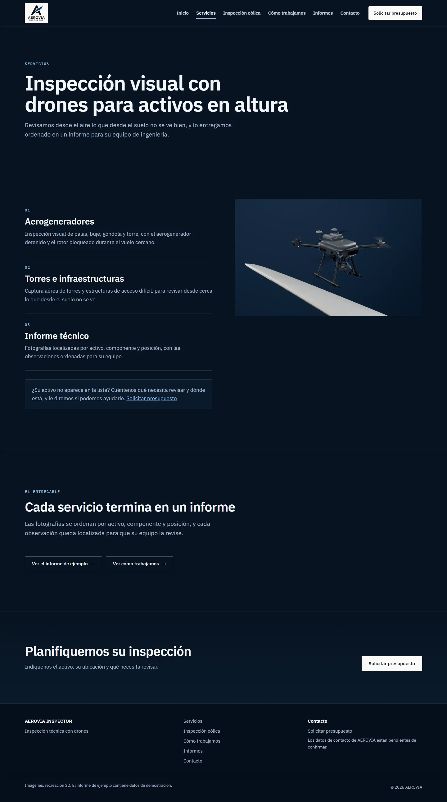 | 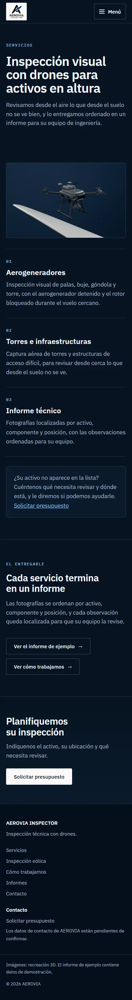 |
| Inspección eólica | 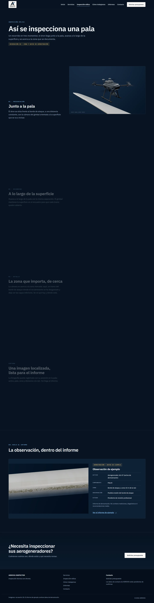 | 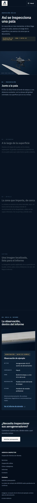 |
| Cómo trabajamos | 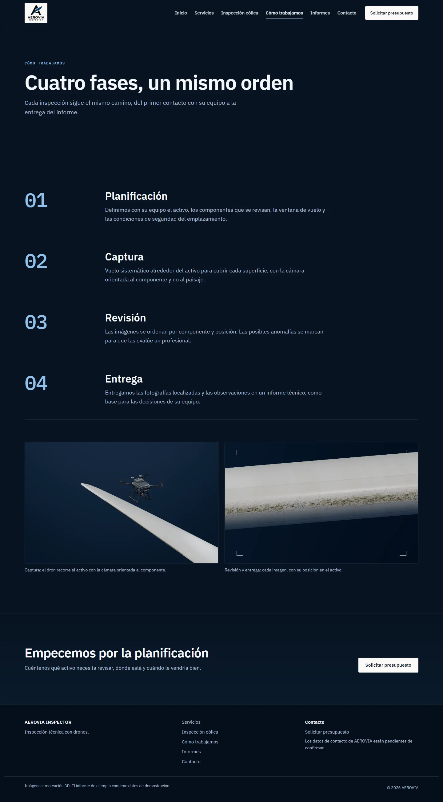 | 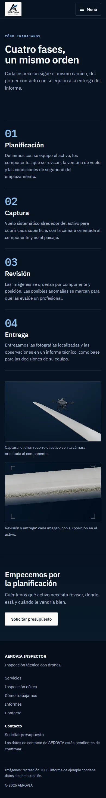 |
| Informes | 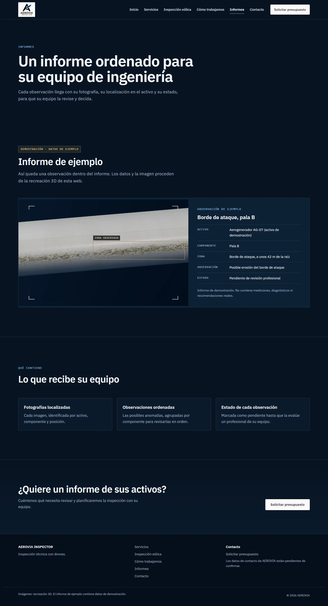 | 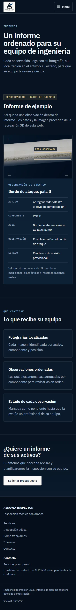 |
| Contacto | 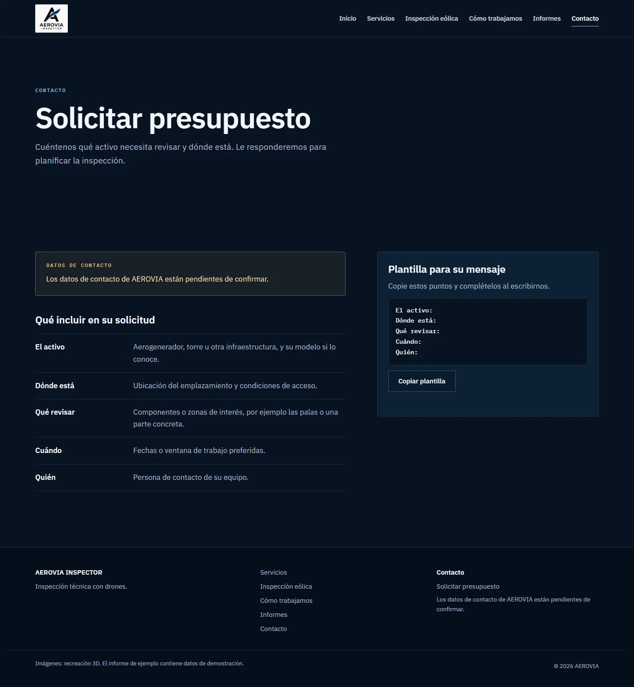 | 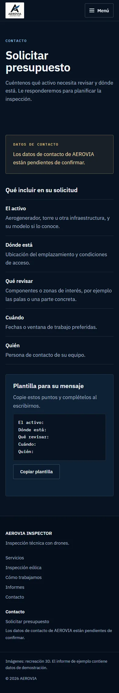 |

- **Rutas reales.** Cada página es un HTML propio en su carpeta, bajo `/aerovia-inspector-demo/`. Un enlace directo, recargar, atrás y adelante y una dirección sin barra final funcionan como en GitHub Pages. Las direcciones que no existen muestran la página 404 del sitio.
- **Partes comunes.** La cabecera, el menú y el pie son los mismos en todas las páginas. El menú abre páginas, no anclas, y marca la actual. En pantallas estrechas es un desplegable que funciona también sin JavaScript.
- **Contacto sin formulario.** No hay un destino configurado, así que no hay nada que aparente enviar. La página dice qué conviene incluir en la solicitud y ofrece una plantilla para copiar. El correo y el teléfono aparecerán cuando AEROVIA los confirme.
- **Textos.** Salen del contenido ya confirmado. No hay cifras, clientes, certificaciones ni capacidades nuevas. El informe y la zona marcada están rotulados como demostración.

## 4. Inspección eólica: el recorrido por scroll

| Momento 1 | Momento 2 |
| --- | --- |
| 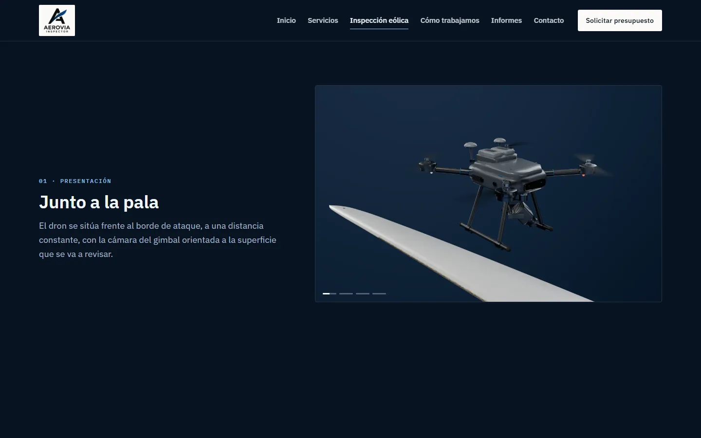 | 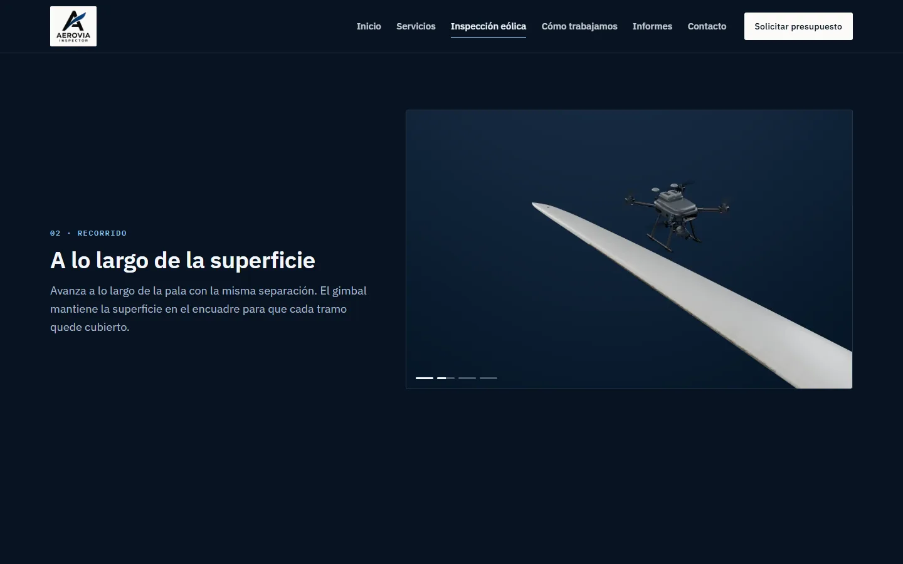 |
| **Momento 3** | **Captura** |
| 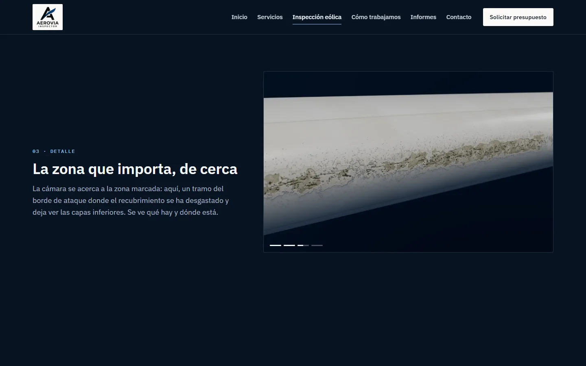 | 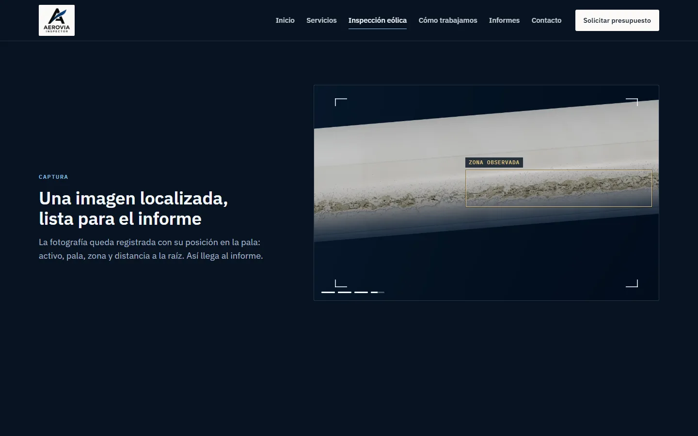 |

- **Funcionamiento.** Las imágenes comparten un escenario fijo y cambian con un fundido según la posición del scroll: avanzan, retroceden y se paran con él. El texto va en su columna (en móvil vertical, debajo de la imagen) y nunca encima del dron ni de la pala.
- **Imágenes actuales.** Usa los fotogramas clave de esta revisión. Cuando se apruebe, la secuencia renderizada entra en el mismo escenario.
- **Alternativas.** Con movimiento reducido o sin JavaScript, cada momento se ve como imagen con su texto, sin animación.

## 5. Lo que queda pendiente

1. **Tu aprobación de las dos capturas** (dron y detalle). Después se renderiza la secuencia larga en horizontal y en vertical: unos 150–200 fotogramas por formato.
2. **El modelo definitivo del dron.** Hay dos caminos:
   - el modelo o las fotos de referencia del dron de AEROVIA, con su permiso;
   - un modelo genérico glTF/GLB con licencia CC0, o CC BY 4.0 con atribución.

   No se ha descargado ni comprado nada. Si el modelo cambia antes de la secuencia, esta se renderiza ya con él.
3. **Datos de AEROVIA:** correo, teléfono y logo vectorial.
4. **Publicación,** solo con tu autorización.
